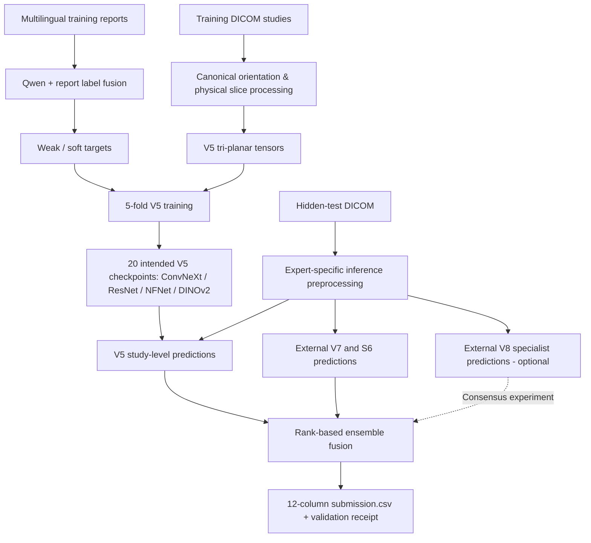
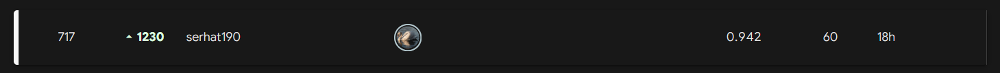

# RSNA Knee MRI Abnormality Detection (2026)

**A 25-day independent ML engineering project: multilingual report supervision, tri-planar MRI learning, and audited multi-expert inference.**

[](https://www.python.org/)
[](https://pytorch.org/)
[](https://www.kaggle.com/competitions/rsna-knee-abnormality-detection)

> **Result:** **717th final rank** · **0.942 final/private macro ROC-AUC** · **0.957 best public macro ROC-AUC** · **25-day participation**. The final leaderboard screenshot displayed **↑ 1,230 places**. Public and private scores refer to different test subsets and should not be interpreted as directly comparable measurements on the same cases.

## Problem

The [2026 RSNA Knee Abnormality Detection challenge](https://www.kaggle.com/competitions/rsna-knee-abnormality-detection) asked participants to predict **12 abnormalities** from each knee MRI study: ACL, MCL, medial/lateral meniscus, medial/lateral/patellofemoral osteoarthritis, effusion, synovitis, Baker's cyst, contusion, and fracture. The metric was **macro ROC-AUC**, averaging the 12 class-specific AUCs.

A central challenge was **limited expert supervision**. The working dataset contained **4,407 training studies, of which 58 had expert reference labels**; the remaining records primarily provided multilingual radiology reports rather than explicit per-finding labels. This made weak supervision, label quality, scanner variation, and careful validation central concerns.

## My 25-day competition journey

I joined the competition with only **25 days remaining**. I spent roughly the **first two weeks learning the problem before committing to large-scale experiments**: studying the anatomy and biomechanics of the knee, understanding how ACL/MCL injuries, meniscal findings, osteoarthritis and fluid-related conditions appear across sagittal, coronal and axial MRI views, and reading relevant medical-imaging and deep-learning research. I also compared CNNs, vision transformers, 2.5D/tri-planar approaches, attention and pooling methods, and the mathematics behind training and evaluation—from backpropagation and class-weighted binary cross-entropy to self-attention, generalized-mean pooling and ROC-AUC.

That left approximately **11 days for intensive implementation, training, debugging and ensemble experimentation**. I trained my own V5 models, iterated on preprocessing and checkpoint compatibility, and integrated externally developed expert systems into the final inference pipeline. Across the sprint I made **around 60 Kaggle submissions**, testing model combinations, inference corrections, TTA, rank fusion and pathology-specific weights. Those submissions accelerated feedback, but also illustrated the risk of repeatedly tuning against a small public leaderboard.

The project therefore reflects both **domain research** and **hands-on engineering under a very constrained timeline**. The research was valuable; in retrospect, I would have started validating a minimal end-to-end baseline alongside it so that I could uncover data and inference problems earlier.

## What I built

- **LLM-assisted report labeling.** Extracted structured per-finding targets from multilingual reports using **Qwen2.5-7B-Instruct** and blended them with another report-derived label source. Used **soft targets** rather than assuming all reports contained clean binary annotations. In the V5 training experiments, gold-labeled cases received higher training weights, and held-out folds were evaluated separately.
- **Geometry-aware DICOM processing.** Implemented slice ordering from `ImageOrientationPatient` / `ImagePositionPatient`, canonical anatomical orientation, modality LUT and MONOCHROME1 handling, series selection, and physically consistent resizing/padding. Cached 16 slices per plane as 288×288 grayscale tensors for the V5 pipeline, with missing-plane masks.
- **Original four-family V5 training.** Trained a five-fold, three-plane model ensemble using **ConvNeXt-Small**, **ResNet50D**, **ECA-NFNet-L0**, and **DINOv2 ViT-S/14** (**20 checkpoints** in the intended full ensemble). CNN paths used one-channel MRI inputs; DINOv2 used three-channel inputs with architecture-specific token pooling.
- **Multi-expert inference integration.** Combined my V5 pipeline with independently developed **V7/R7** and **S6** model packages, later experimenting with a separate **V8 specialist**. Built offline Kaggle inference orchestration, checkpoint checks, stage receipts, failure reporting, and rank-based fusion. **V7, S6, and V8 were external expert systems; this repository does not claim their original model training or authorship.**
- **Debugging and reproducibility.** Diagnosed the 1-vs-3-channel checkpoint mismatch, legacy DICOM preprocessing mismatch, missing-plane handling, GPU memory limitations, data-loader deadlocks, and checkpoint-level image-size incompatibilities.

## System overview



*The diagram is a conceptual overview, not a claim that the V7, S6, V8, and V5 engines share identical preprocessing.*

## Results and experiments

| Stage / selected experiment | Reported public AUC | Main lesson |
| --- | ---: | --- |
| Early partially loaded inference | **0.823** | Fifteen CNN checkpoints were skipped after a channel mismatch; the result was not the intended full ensemble. |
| Single ResNet34 (ImageNet-pretrained) | **0.877** | A single-backbone reference point before the stronger multi-family ensembles. |
| First functional four-family inference | **0.879** | Correct checkpoints are not enough if inference preprocessing differs from training. |
| Later four-family improvements | **0.890** | Incremental gains from inference fixes and controlled experiments. |
| Standalone S6 published expert (integrated, not trained here) | **0.950** | An external model added a strong, complementary prediction source. |
| V7-only published expert (integrated, not trained here) | **0.956** | High-quality external baseline. |
| **Fixed V7/S6/V5 blend (60/25/15)** | **0.957** | Strongest documented stable three-expert recipe. |
| **V8 Consensus + Mild DINOv2 TTA** | **0.956** | Greater prediction diversity; dynamic gating was heuristic, not an accuracy-calibrated error detector. |
| Final Kaggle leaderboard | **0.942 private** | **Rank 717**; actual private metric differed from public evaluation. |

**Finalist configurations:** The fixed blend used **60% V7 + 25% S6 ConvNeXt B-only + 15% V5**. The second finalist, **V8 Consensus + Mild DINOv2 TTA**, allocated a dynamic **10–50%** to V8 based on rank-disagreement heuristics while redistributing the remaining weight in the 60:25:15 proportion. Its visible three-study run recorded mean V8 weight **0.243089**, maximum **0.50**, and completed all four expert stages; those three cases do not measure hidden-set performance.

**Important experiment-name correction:** An uploaded notebook titled `rsna_pathology_steady_60_25_15` actually sets a **12-target pathology-specific weight override**. It should **not** be mistaken for the fixed 60/25/15 submission. See [experiment provenance](docs/experiments.md).

### What changed from public to private?

The screenshot showed the final position at **717th** with **↑ 1,230 places**, despite the final AUC (**0.942**) being below the best public AUC (**0.957**). A relative rank gain can happen when **other submissions fall further**, even if our own AUC also falls. Kaggle's public and private leaderboards use different holdout subsets (approximately 30% vs. 70% of the test data).

The competition's small expert-labeled training subset and noisy report-derived supervision create a **plausible overfitting / model-selection risk**. Repeated selection against a small public leaderboard can also favor changes that do not transfer to the private set. **These are possible explanations, not evidence that particular competitors overfit**. We do not have other teams' training histories, held-out scores, or patient-level error analyses. The 0.015 public-to-private drop in our own score is itself a reason to be cautious about generalization claims. See [generalization discussion](docs/generalization.md).

## Engineering lessons

1. **Training/inference parity is critical.** Matching checkpoint keys without matching normalization, spatial orientation, and sampling can significantly degrade performance.
2. **Weak-label supervision needs careful validation.** 58 expert-labeled cases can guide model selection but do not support sweeping conclusions about generalization.
3. **Model diversity isn't the same as error independence.** Multiple architectures may share labeling or acquisition biases; rank-disagreement gating is not automatically an error detector.
4. **AUC is a ranking metric.** Post-processing must be judged by held-out ranking quality, not by the visual confidence of probabilities.
5. **Reproducibility is part of the model.** Checkpoint integrity, provenance, data leakage safeguards, and truthful partial-completion flags were essential to deployment.

## What I would do differently if I entered this competition again

The clearest lesson from this project is that **more models, more TTA and more ensemble tuning do not necessarily fix errors learned from the same imperfect supervision**. My ConvNeXt, ResNet50D, NFNet and DINOv2 models were architecturally different, but they could still learn *correlated mistakes* if trained on similar noisy report-derived targets. The same concern applies when integrating external experts, even though their training sources may differ.

If I started again, I would change the order of investment:

1. **Establish an end-to-end baseline early.** In parallel with the first anatomy and literature review, I would validate a small training/inference run, DICOM geometry, checkpoint restoration and submission schema. This would leave more time to improve core methodology instead of discovering preprocessing mismatches near the deadline.
2. **Spend substantially more time on label quality.** I would audit the 12-pathology labeling taxonomy against expert-labeled examples, preserve distinctions between *negative*, *not mentioned*, *uncertain* and *positive*, and manually review difficult report phrases and potential LLM extraction failures. With only 58 expert-labeled training studies, the reference labels would be used carefully rather than repeatedly optimized against.
3. **Experiment with more diverse sources of supervision.** Instead of relying primarily on closely related LLM-generated labels, I would compare independent report-extraction methods (e.g., Qwen, other language models, clinical rules and targeted human review where feasible), measure their disagreements, and train with confidence-aware or masked targets. **Diverse labels are a hypothesis to test—not an automatic cure**: several language models can repeat the same report ambiguity, and no pseudo-label should be treated as a new independent ground-truth case.
4. **Measure shared errors explicitly.** I would create patient-disjoint out-of-fold predictions for every model and label source, then investigate per-pathology false positives/negatives, error correlation, scanner or acquisition shifts and whether an alternative model corrects *actual mistakes*, not merely disagrees. I would try a supervised error-risk or stacking layer only if nested validation showed a reproducible AUC improvement.
5. **Protect generalization and simplify selection.** I would reserve independent validation where feasible, verify grouping at the *patient* rather than just study level, record confidence intervals for per-class AUC, and make fewer leaderboard-driven decisions. Rather than around 60 submissions driving repeated heuristic changes, I would organize a smaller set of pre-declared experiments with a clear rationale and an untouched evaluation protocol.

I would also revisit **anatomy-focused localization and higher-coverage slice sampling** for subtle focal abnormalities, but only after better labels and stronger validation were in place. Higher resolution or more windows cannot repair systematic target errors on their own.

### What I learned

- **The data pipeline is part of the model.** Physical orientation, DICOM windowing, consistent sampling and exact training/inference parity can matter as much as another architecture.
- **Medical context affects engineering choices.** Understanding the knee helped me reason about plane selection, left/right anatomy, finding-specific attention and why careless flips may break labels.
- **Weak supervision has a ceiling.** The limiting factor may be what a model is being taught rather than the capacity of its network.
- **Diversity should be measured, not assumed.** Different architectures and label generators can produce strongly correlated errors; disagreement is not the same as correctness.
- **Leaderboard metrics are noisy estimates.** Our best public AUC was 0.957 while the final private AUC was 0.942, even though the displayed rank improved to 717th. Neither public improvement nor relative private movement proves a particular generalization mechanism.
- **Reproducibility and honest failure analysis matter.** Checkpoint mismatches, runtime failures and unsuccessful experiments became some of the most useful technical findings in this 25-day project.

## Repository contents

```text
.
├── README.md
├── docs/
│   ├── methodology.md
│   ├── experiments.md
│   ├── generalization.md
│   ├── leaderboard-snapshot.md
│   ├── provenance-and-data.md
│   └── cv-entry.md
├── research/
│   ├── README.md
│   ├── architecture/tri_planar_cnn.py
│   ├── training/loss_and_metrics.py
│   ├── oof/rsna_4family_ensemble_v2_7.py
│   └── experiments/four_expert_pathology_weights.csv
├── examples/fixed_60_25_15.json
├── src/reference_rank_blend.py
├── tests/test_reference_rank_blend.py
├── requirements.txt
├── .gitignore
└── LICENSING.md
```

**Scope:** The repository contains selected research source code, a standalone educational rank-fusion utility, tests, and technical documentation. It does **not** redistribute MRI studies, individual labels, checkpoints, or external expert inference engines. The reference fusion code is not claimed to reproduce the Kaggle run byte-for-byte. See [source provenance](docs/provenance-and-data.md).

## Final leaderboard screenshot



The screenshot was supplied by the author. The repository stores an SVG wrapper containing the original PNG image data. The final result was **717th** at **0.942 private macro AUC**, with a displayed change of **+1,230 positions**. This does not prove other teams overfitted, nor that the private score increased.

## Reusable training modules

The [training portfolio update](docs/PORTFOLIO_UPDATE.md) adds a **working, smoke-tested research adaptation** of the DINOv2 and NFNet training architecture. These are **not guaranteed to restore the original competition checkpoints**.

- [DINOv2 ViT-S/14](src/models/triplanar_dinov2.py) — CLS/mean/focal patch pooling, frozen-prefix option, focal slice attention and anatomy-informed plane prior; [architecture documentation](docs/models/dinov2.md)
- [ECA-NFNet-L0](src/models/triplanar_nfnet.py) — one-channel MRI, GeM pooling, masked slice transformer; [architecture documentation](docs/models/nfnet.md)
- [Shared model components](src/models/common.py), [cache loader](src/data/cached.py), [DICOM geometry helpers](src/data/geometry.py), and [training and AUC utilities](src/training/engine.py)
- [CPU smoke tests](tests/test_training_modules.py) and [geometry tests](tests/test_geometry.py): model forward/backward, missing planes, data safety, soft labels, fold grouping and physical slice ordering
- [Configuration examples](configs/) — illustrating historical Phase-3 settings without asserting exact per-fold checkpoint parity
- [DICOM canonical preprocessing notes](docs/models/preprocessing.md) — validated physical-coordinate operations and limitations

```bash
python -m pip install -r requirements-research.txt
python -m unittest discover -s tests -v
```

## Selected original research code

The repository now includes source-derived examples in [`research/`](research/README.md):

- [Tri-planar CNN architecture](research/architecture/tri_planar_cnn.py) — slice transformer, single-channel TIMM models, three-plane fusion, and GeM/mean pooling.
- [Training loss and metrics](research/training/loss_and_metrics.py) — study-weighted masked BCE, training-only class weights, and macro ROC-AUC.
- [Four-family OOF calibration audit (v2.7)](research/oof/rsna_4family_ensemble_v2_7.py) — fold validation, leakage guards, nested calibration, and provenance checks.
- [Experimental four-expert pathology weights](research/experiments/four_expert_pathology_weights.csv) — an exploratory configuration, not the fixed 60/25/15 finalist.
- [Final private leaderboard snapshot](docs/leaderboard-snapshot.md) — aggregated results from the supplied 6,425-team export, including final 717th place.

These files document real implementation details, but the training extracts are not standalone runnable programs; see the code archive's [scope and limitations](research/README.md). No patient-level labels or full private leaderboard CSVs were published.

## Reproduce the reference fusion example

```bash
python -m pip install -r requirements.txt
python -m unittest discover -s tests -v
python -m src.reference_rank_blend --v7 v7.csv --s6 s6.csv --v5 v5.csv --out submission.csv
```

All input prediction CSVs must have a unique `StudyInstanceUID` column and the 12 named output columns. The reference utility performs per-target average-rank normalization and a fixed 60/25/15 weighted sum **for demonstration**; the original competition engines have additional preprocessing and calibration steps.

## Credits and responsible use

The V5 four-family training/preprocessing and the ensemble experiments are my project contributions. **The V7, S6, and V8 model families/weights were developed and published by other contributors** and used here as external ensemble experts; their intellectual contributions should be cited via their original model pages and applicable licenses before any redistribution. The RSNA dataset and competition belong to their respective providers. **This is a research competition artifact, not a clinical diagnostic system.**

**Author:** [AnalyticEngine190](https://github.com/AnalyticEngine190) · [Competition](https://www.kaggle.com/competitions/rsna-knee-abnormality-detection) · [RSNA 2026 challenge](https://www.rsna.org/artificial-intelligence/ai-image-challenge/knee-mri-ai-challenge)
