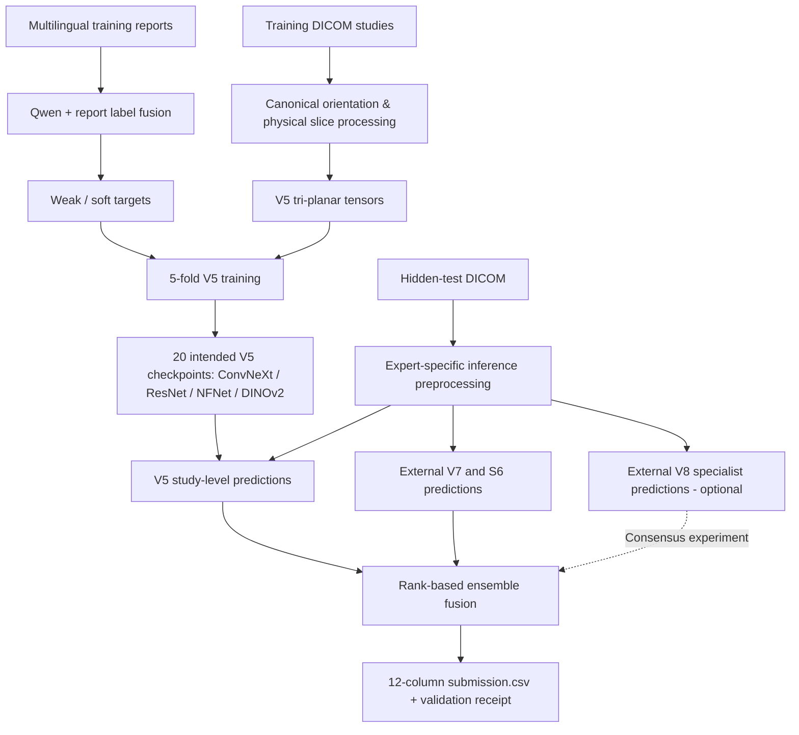

# RSNA Knee MRI Abnormality Detection (2026)

**A 25-day independent ML engineering project: multilingual report supervision, tri-planar MRI learning, and audited multi-expert inference.**

[](https://www.python.org/)
[](https://pytorch.org/)
[](https://www.kaggle.com/competitions/rsna-knee-abnormality-detection)

> **Result:** **717th final rank** · **0.942 final/private macro ROC-AUC** · **0.957 best public macro ROC-AUC** · **25-day participation**. The final leaderboard screenshot displayed **↑ 1,230 places**. Public and private scores refer to different test subsets and should not be interpreted as directly comparable measurements on the same cases.

## Problem

The [2026 RSNA Knee Abnormality Detection challenge](https://www.kaggle.com/competitions/rsna-knee-abnormality-detection) asked participants to predict **12 abnormalities** from each knee MRI study: ACL, MCL, medial/lateral meniscus, medial/lateral/patellofemoral osteoarthritis, effusion, synovitis, Baker's cyst, contusion, and fracture. The metric was **macro ROC-AUC**, averaging the 12 class-specific AUCs.

A central challenge was **limited expert supervision**. The working dataset contained **4,407 training studies, of which 58 had expert reference labels**; the remaining records primarily provided multilingual radiology reports rather than explicit per-finding labels. This made weak supervision, label quality, scanner variation, and careful validation central concerns.

## What I built

- **LLM-assisted report labeling.** Extracted structured per-finding targets from multilingual reports using **Qwen2.5-7B-Instruct** and blended them with another report-derived label source. Used **soft targets** rather than assuming all reports contained clean binary annotations. In the V5 training experiments, gold-labeled cases received higher training weights, and held-out folds were evaluated separately.
- **Geometry-aware DICOM processing.** Implemented slice ordering from `ImageOrientationPatient` / `ImagePositionPatient`, canonical anatomical orientation, modality LUT and MONOCHROME1 handling, series selection, and physically consistent resizing/padding. Cached 16 slices per plane as 288×288 grayscale tensors for the V5 pipeline, with missing-plane masks.
- **Original four-family V5 training.** Trained a five-fold, three-plane model ensemble using **ConvNeXt-Small**, **ResNet50D**, **ECA-NFNet-L0**, and **DINOv2 ViT-S/14** (**20 checkpoints** in the intended full ensemble). CNN paths used one-channel MRI inputs; DINOv2 used three-channel inputs with architecture-specific token pooling.
- **Multi-expert inference integration.** Combined my V5 pipeline with independently developed **V7/R7** and **S6** model packages, later experimenting with a separate **V8 specialist**. Built offline Kaggle inference orchestration, checkpoint checks, stage receipts, failure reporting, and rank-based fusion. **V7, S6, and V8 were external expert systems; this repository does not claim their original model training or authorship.**
- **Debugging and reproducibility.** Diagnosed the 1-vs-3-channel checkpoint mismatch, legacy DICOM preprocessing mismatch, missing-plane handling, GPU memory limitations, data-loader deadlocks, and checkpoint-level image-size incompatibilities.

## System overview



*The diagram is a conceptual overview, not a claim that the V7, S6, V8, and V5 engines share identical preprocessing.*

## Results and experiments

| Stage / selected experiment | Reported public AUC | Main lesson |
| --- | ---: | --- |
| Early partially loaded inference | **0.823** | Fifteen CNN checkpoints were skipped after a channel mismatch; the result was not the intended full ensemble. |
| First functional four-family inference | **0.879** | Correct checkpoints are not enough if inference preprocessing differs from training. |
| Later four-family improvements | **0.889** | Incremental gains from inference fixes and controlled experiments. |
| Standalone S6 published expert (integrated, not trained here) | **0.950** | An external model added a strong, complementary prediction source. |
| V7-only published expert (integrated, not trained here) | **0.956** | High-quality external baseline. |
| **Fixed V7/S6/V5 blend (60/25/15)** | **0.957** | Strongest documented stable three-expert recipe. |
| **V8 Consensus + Mild DINOv2 TTA** | **0.956** | Greater prediction diversity; dynamic gating was heuristic, not an accuracy-calibrated error detector. |
| Final Kaggle leaderboard | **0.942 private** | **Rank 717**; actual private metric differed from public evaluation. |

**Finalist configurations:** The fixed blend used **60% V7 + 25% S6 ConvNeXt B-only + 15% V5**. The second finalist, **V8 Consensus + Mild DINOv2 TTA**, allocated a dynamic **10–50%** to V8 based on rank-disagreement heuristics while redistributing the remaining weight in the 60:25:15 proportion. Its visible three-study run recorded mean V8 weight **0.243089**, maximum **0.50**, and completed all four expert stages; those three cases do not measure hidden-set performance.

**Important experiment-name correction:** An uploaded notebook titled `rsna_pathology_steady_60_25_15` actually sets a **12-target pathology-specific weight override**. It should **not** be mistaken for the fixed 60/25/15 submission. See [experiment provenance](docs/experiments.md).

### What changed from public to private?

The screenshot showed the final position at **717th** with **↑ 1,230 places**, despite the final AUC (**0.942**) being below the best public AUC (**0.957**). A relative rank gain can happen when **other submissions fall further**, even if our own AUC also falls. Kaggle's public and private leaderboards use different holdout subsets (approximately 30% vs. 70% of the test data).

The competition's small expert-labeled training subset and noisy report-derived supervision create a **plausible overfitting / model-selection risk**. Repeated selection against a small public leaderboard can also favor changes that do not transfer to the private set. **These are possible explanations, not evidence that particular competitors overfit**. We do not have other teams' training histories, held-out scores, or patient-level error analyses. The 0.015 public-to-private drop in our own score is itself a reason to be cautious about generalization claims. See [generalization discussion](docs/generalization.md).

## Engineering lessons

1. **Training/inference parity is critical.** Matching checkpoint keys without matching normalization, spatial orientation, and sampling can significantly degrade performance.
2. **Weak-label supervision needs careful validation.** 58 expert-labeled cases can guide model selection but do not support sweeping conclusions about generalization.
3. **Model diversity isn't the same as error independence.** Multiple architectures may share labeling or acquisition biases; rank-disagreement gating is not automatically an error detector.
4. **AUC is a ranking metric.** Post-processing must be judged by held-out ranking quality, not by the visual confidence of probabilities.
5. **Reproducibility is part of the model.** Checkpoint integrity, provenance, data leakage safeguards, and truthful partial-completion flags were essential to deployment.

## Repository contents

```text
.
├── README.md
├── docs/
│   ├── methodology.md
│   ├── experiments.md
│   ├── generalization.md
│   ├── provenance-and-data.md
│   └── cv-entry.md
├── examples/fixed_60_25_15.json
├── src/reference_rank_blend.py
├── tests/test_reference_rank_blend.py
├── requirements.txt
├── .gitignore
└── LICENSING.md
```

**Scope:** This repository includes an **original educational reference implementation of rank fusion** and detailed engineering documentation. It **does not** include medical images, patient records, competition labels, proprietary/model-weight bundles, or the executable full V7/S6/V8 inference engines. The reference blend is **not claimed to reproduce Kaggle inference byte-for-byte**. See [data and provenance notes](docs/provenance-and-data.md).

## Selected original research code

The repository now includes source-derived examples in [`research/`](research/README.md):

- [Tri-planar CNN architecture](research/architecture/tri_planar_cnn.py) — slice transformer, single-channel TIMM models, three-plane fusion, and GeM/mean pooling.
- [Training loss and metrics](research/training/loss_and_metrics.py) — study-weighted masked BCE, training-only class weights, and macro ROC-AUC.
- [Four-family OOF calibration audit (v2.7)](research/oof/rsna_4family_ensemble_v2_7.py) — fold validation, leakage guards, nested calibration, and provenance checks.
- [Experimental four-expert pathology weights](research/experiments/four_expert_pathology_weights.csv) — an exploratory configuration, not the fixed 60/25/15 finalist.
- [Final private leaderboard snapshot](docs/leaderboard-snapshot.md) — aggregated results from the supplied 6,425-team export, including final 717th place.

These files document real implementation details, but the training extracts are not standalone runnable programs; see the code archive's [scope and limitations](research/README.md). No patient-level labels or full private leaderboard CSVs were published.

## Reproduce the reference fusion example

```bash
python -m pip install -r requirements.txt
python -m unittest discover -s tests -v
python -m src.reference_rank_blend --v7 v7.csv --s6 s6.csv --v5 v5.csv --out submission.csv
```

All input prediction CSVs must have a unique `StudyInstanceUID` column and the 12 named output columns. The reference utility performs per-target average-rank normalization and a fixed 60/25/15 weighted sum **for demonstration**; the original competition engines have additional preprocessing and calibration steps.

## Credits and responsible use

The V5 four-family training/preprocessing and the ensemble experiments are my project contributions. **The V7, S6, and V8 model families/weights were developed and published by other contributors** and used here as external ensemble experts; their intellectual contributions should be cited via their original model pages and applicable licenses before any redistribution. The RSNA dataset and competition belong to their respective providers. **This is a research competition artifact, not a clinical diagnostic system.**

**Author:** [AnalyticEngine190](https://github.com/AnalyticEngine190) · [Competition](https://www.kaggle.com/competitions/rsna-knee-abnormality-detection) · [RSNA 2026 challenge](https://www.rsna.org/artificial-intelligence/ai-image-challenge/knee-mri-ai-challenge)
